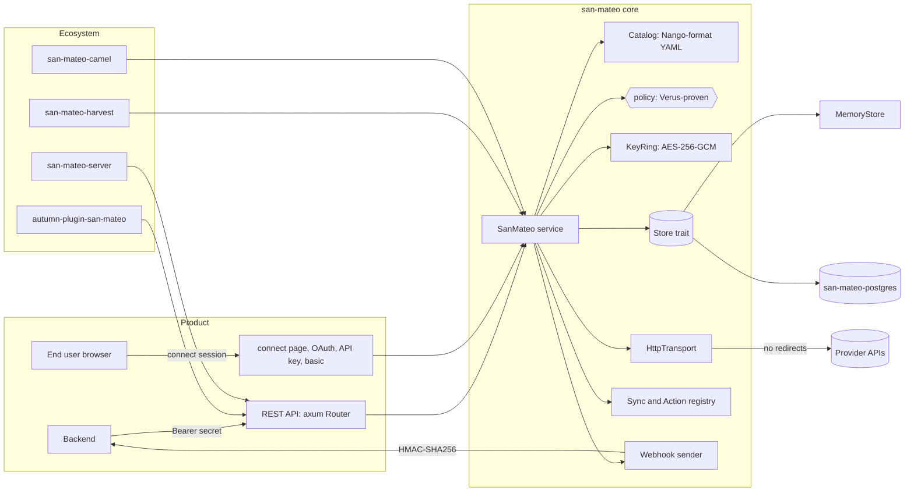

# Plan: San Mateo

Style: ASD-STE100. Short sentences. Active voice. One topic in each sentence.

## 1. Problem

Nango is an integration platform. It keeps OAuth tokens and API keys for the
users of a product. It refreshes tokens. It sends authorized calls to more
than 1,000 APIs through a proxy. It runs syncs and actions, and it keeps the
records that syncs make. Nango is TypeScript (about 40 packages) and uses the
Elastic License 2.0.

The autumn ecosystem is Rust:

- `autumn-web` is the web framework.
- `autumn-harvest` is the durable workflow engine.
- `harvest-camel` connects rust-camel routes to harvest.

The ecosystem has no integration auth layer. A harvest workflow that calls
HubSpot must keep its own OAuth token and refresh it. A camel route that calls
Salesforce must do the same.

San Mateo is a Rust integration platform with the core functions of Nango. It
is a clean-room implementation under Apache-2.0. It installs into each part of
the ecosystem.

No GitHub issue exists for this work. Section 9 gives the acceptance criteria.

## 2. Research (sources)

| Source | Finding | San Mateo use |
|---|---|---|
| `nango/packages/providers/providers.yaml` | 1,048 providers. 82% use `API_KEY` (348), `OAUTH2` (307), `OAUTH2_CC` (106), `BASIC` (101) or `NONE` (2). | Support these five modes in v0.1. Read the Nango YAML format. |
| `nango/packages/shared/.../refresh.ts` | Refresh margin 15 min. Failure cooldown 30 s. Exhausted after 4 failed days. Lock for each connection. | Same rules. Verus proof for the rules. |
| `nango/packages/shared/lib/services/proxy/*` | `Connection-Id`, `Provider-Config-Key`, `Retries`, `Base-Url-Override`, `Nango-Proxy-*` headers. Retries on 5xx, 429 and 401. Provider `retry.at` and `retry.after` headers. | Same headers. Safer retry rules. See ADR 0004. |
| `nango/packages/utils/lib/encryption.ts` | AES-256-GCM. No key rotation. No row binding. | AES-256-GCM with key ids and row-bound AAD. See ADR 0003. |
| `nango/packages/records` | Stable id from uuid v5. Content hash. `(updated_at, id)` cursor. | Same model. Keyed hash. |
| `nango/packages/webhooks` | `X-Nango-Hmac-Sha256` = HMAC-SHA256 of the body. | Same header, and `X-San-Mateo-Hmac-Sha256`. |
| `nango/packages/types/lib/*/api.ts` | JSON shapes of the public API. | Wire-compatible shapes for the core endpoints. |
| `autumn/autumn/src/plugin.rs` | `Plugin { name, build, contract }`. `nest` + `declare_plugin_routes`. | `SanMateoPlugin`. |
| `autumn-plugin-slack` | `HttpTransport` + `MemoryTransport`. Verus-proven policy. 85% coverage gate. | The same structure. |
| `autumn-harvest` | Activities are fn pointers. They read state with `ctx.state::<T>()`. One schedule for each workflow name. | Activities read `SanMateo` from state. A sync is an entity workflow with `timer` and `continue_as_new`. |
| `harvest-camel/src/route.rs` | 5xx, 408, 425 and 429 are retryable activity failures. | Same mapping for proxy failures. |
| `camel-component-api` 0.57 | `Component`, `Endpoint`, `BoxProcessor`. | `san-mateo:` producer. |

## 3. Brainstorming (use cases)

1. **Connect an account.** The product backend makes a connect session. The end user opens a link and grants access with OAuth, an API key, or a user name and password.
2. **Get a token.** The backend gets fresh credentials for a connection. San Mateo refreshes them when they expire soon.
3. **Proxy a call.** The backend sends `GET /proxy/crm/v3/contacts`. San Mateo adds the auth, retries on a rate limit, and gives back the reply.
4. **Run a sync.** A Rust sync function reads pages from the API and saves records. The backend reads the changes with a cursor.
5. **Run an action.** The backend calls a Rust action function with JSON input. It gets JSON output.
6. **Get events.** The backend gets signed webhooks for new connections, refresh failures and sync results.
7. **Use it in autumn.** One `.plugin(SanMateoPlugin::new())` call adds the API to an autumn app.
8. **Use it in harvest.** A workflow calls a provider API in an activity. A sync runs as a durable workflow.
9. **Use it in camel.** A route sends `to("san-mateo:hubspot?connectionId=c1&path=/crm/v3/contacts")`.
10. **Run it alone.** One binary runs the API with Postgres or in memory.
11. **Move from Nango.** A Nango SDK client points to San Mateo and works for the core endpoints.
12. **Later (not in scope):** OAuth 1.0a, JWT, GitHub App, TWO_STEP and the other modes. A React Connect UI. A dashboard. Deploy of TypeScript functions. Provider webhook routing scripts. MCP server. Multi-account billing.

Selected scope: items 1 to 11.

## 4. Reverse brainstorming (how to make it fail)

| How to fail | Counter-measure |
|---|---|
| Leak tokens from the database. | Encrypt credentials with AES-256-GCM before the store gets them. The store never sees plaintext. |
| Move an encrypted token to a different connection row. | AAD binds the ciphertext to environment, integration and connection id. A moved row does not decrypt. |
| Lose all data when the key changes. | A key ring with key ids. Encrypt with the active key. Decrypt with any listed key. |
| Leak tokens in logs or panics. | `Secret` has a redacting `Debug`. Never log bodies or headers with auth. |
| Forge the OAuth callback (CSRF). | 256-bit random `state`. It is single use. It expires in 15 min. The store keeps only its hash. |
| Steal the authorization code. | PKCE S256, unless the provider sets `disable_pkce`. |
| Send credentials to an attacker host with `Base-Url-Override`. | Accept only the provider host or a host in the allow list. HTTPS only (plain HTTP only for loopback, when enabled). |
| Inject a host through `${connectionConfig.subdomain}`. | Check values against the provider `pattern`. Reject URL delimiters in values. Percent-encode values in URLs. |
| SSRF to cloud metadata (`169.254.169.254`). | Reject private, loopback and link-local IP literals in upstream URLs, unless enabled for tests. |
| Leak the token on an HTTP redirect. | The transport never follows redirects. |
| Two refreshes at the same time. One rotated refresh token is lost. | Single flight in the process. A store lease across processes. Version check (CAS) on write. |
| Lose the refresh token when the provider omits it. | Keep the old refresh token. |
| Refresh in a loop against a broken provider. | 30 s cooldown after a failure. Exhausted after 4 days with failures. |
| Do a `POST` two times after a 5xx. | Retry 5xx and network errors only for idempotent methods. A caller can opt in with `Retry-On`. |
| Wait for a long time on a large `Retry-After`. | Cap the wait. Give up above the cap. Proven in the Verus spec. |
| Retry for ever. | Bounded attempts (max 10). Proven in the Verus spec. |
| Use too much memory for a large upstream reply. | Cap the reply body (default 25 MiB). |
| Guess or brute force the secret key. | 256-bit random keys. Keyed hash lookup. Constant-time compare. |
| Reuse an expired connect session. | TTL 30 min. Checked at each use. The store keeps only the token hash. |
| A forged webhook to the product. | HMAC-SHA256 signature on the exact body bytes. |
| Duplicate records after a sync retry. | Stable record id from uuid v5. Content hash. Unchanged records give no event. |
| Lose records between two reads. | Cursor on `(updated_at, id)`. Strict tuple compare. |
| Two sync runs for one connection at the same time. | One run at a time for each (connection, sync). Harvest: concurrency key. |
| Copy Nango code under ELv2 into an Apache-2.0 crate. | Clean-room code. Read only the public file format and API shapes. The built-in catalog comes from public provider docs. See ADR 0001. |
| Tie the core to one framework. | The core crate has no autumn, harvest or camel dependency. Adapters are separate crates. See ADR 0005. |
| Tests need real providers. | `HttpTransport` trait with `MemoryTransport`. A local fake server tests the real transport. |

## 5. Six thinking hats

- **White (facts):** Nango has 1,048 providers in one YAML file. Five auth modes cover 82% of them. OAuth2 token replies are not uniform: `expires_in` can be seconds or milliseconds, the token can be under a nested path, and some providers need Basic client auth or a JSON body. autumn-web 0.8 uses diesel-async 0.9 and deadpool 0.13. autumn-harvest 0.7 uses the same pool type. A harvest schedule is unique for each workflow name. rust-camel 0.57 components implement `Component` and `Endpoint`, and a producer is a `BoxProcessor`.
- **Red (feelings):** Users want `san.proxy(conn).get("/v3/contacts")` and nothing more. Users fear token leaks most. Users of Nango want their SDK calls to keep working.
- **Black (risks):** OAuth providers have many quirks. We cannot test all providers without accounts. Mitigation: a data-driven catalog, the `MemoryTransport`, and a parse test over the full Nango YAML. Licence risk: Nango is ELv2. Mitigation: ADR 0001. Compile time is high with autumn, harvest and camel in one workspace. Mitigation: the core has few dependencies. The adapters are separate crates. Cross-process refresh needs a lock. Mitigation: a store lease with an expiry.
- **Yellow (benefits):** One Rust binary, low memory, no Redis. Durable syncs on harvest. Typed Rust syncs and actions. Row-bound encryption and key rotation. Provider data from the Nango format, so users can bring their own YAML.
- **Green (ideas):** Wire compatibility with the Nango API. A Verus-proven refresh and retry policy. Harvest `ActivityFailure` mapping that follows harvest-camel. A camel component, so all 30 camel connectors can feed San Mateo calls. A minimal hosted connect page, so no React app is needed.
- **Blue (process):** Write the Verus spec for the policy first. Write failing tests (RED). Implement (GREEN). Refactor with tests green. Do this for each crate. Then review with agents from several angles. Then check each AC with evidence.

## 6. Design

### 6.1 Crates

| Crate | Contents | Depends on |
|---|---|---|
| `san-mateo` | Core. Model, catalog, templates, policy, crypto, OAuth2, transport, proxy, pagination, records, store trait, memory store, syncs and actions, webhooks, service, axum API. | tokio, axum, reqwest (rustls + ring), aes-gcm, hmac, sha2, serde. |
| `san-mateo-postgres` | `PgStore` with diesel-async. SQL migrations. | `san-mateo`, diesel-async 0.9, deadpool 0.13. |
| `san-mateo-server` | The `san-mateo` binary. Config from env vars. | `san-mateo`, `san-mateo-postgres`. |
| `autumn-plugin-san-mateo` | `SanMateoPlugin` for autumn-web 0.8. | `san-mateo`, `autumn-web`. |
| `san-mateo-harvest` | Activities and workflows for autumn-harvest 0.7. | `san-mateo`, `autumn-harvest`. |
| `san-mateo-camel` | `san-mateo:` component for rust-camel 0.57. | `san-mateo`, camel crates. |

### 6.2 Core modules (`san-mateo`)

- `policy`: pure functions. Token expiry, refresh gate, failure count, retry decision, backoff. Verified core. Same text as `verus/policy.rs`.
- `clock`: `Clock` and `Entropy` seams. System and fixed versions.
- `secret`: `Secret` string with a redacting `Debug`.
- `crypto`: `KeyRing`. AES-256-GCM seal and open with AAD. Keyed hash for lookups.
- `provider`: Nango-format provider model, `AuthMode`, `Catalog` (YAML, aliases, built-in catalog).
- `template`: `${...}` interpolation, `||` fallback, `base64(...)`, URL-safe values.
- `credentials`: `Credentials` enum. Nango-compatible JSON.
- `oauth2`: authorize URL, PKCE, token request, token reply parse, refresh request, client credentials request.
- `transport`: `HttpTransport`, `ReqwestTransport`, `MemoryTransport`.
- `proxy`: upstream URL, auth headers, header rules, SSRF checks, retry loop.
- `paginate`: cursor, link and offset pagination.
- `records`: stable id, keyed content hash, classify, cursor codec.
- `store`: `Store` trait, stored types, `MemoryStore`, and a shared conformance test suite.
- `functions`: `Sync` and `Action` traits, contexts, `Registry`, in-process scheduler.
- `webhook`: outbound event types, signer, sender with bounded retry.
- `service`: `SanMateo` facade and builder. Connect sessions, auth flows, connections, refresh, proxy, records, syncs, actions.
- `api`: axum `Router` with the public REST API and the connect page.
- `error`: `Error` with stable codes. JSON `{"error":{"code","message"}}`.

### 6.3 Data flow: OAuth2

1. Backend: `POST /connect/sessions` gives `{token, connect_link, expires_at}`.
2. Browser: `GET /oauth/connect/{integration}?connect_session_token=...`.
3. San Mateo stores an OAuth session (state hash, PKCE verifier, connection config). It replies 302 to the provider.
4. Provider: redirect to `GET /oauth/callback?code&state`.
5. San Mateo takes the session (single use), posts the token request, parses the reply, seals the credentials, stores the connection, sends the `auth` webhook, and shows a result page.

### 6.4 Data flow: refresh

1. A caller asks for a connection.
2. `policy::token_expired(now, expires_at, buffer)` decides.
3. `policy::refresh_gate` blocks a refresh in cooldown or after exhaustion (unless forced).
4. Single flight: one refresh for each connection key in the process.
5. The store lease blocks other processes. After the lease, read the row again. If it is fresh, use it.
6. Write with a version check.

### 6.5 Data flow: proxy

1. Resolve the connection with fresh credentials.
2. Build the upstream URL from `proxy.base_url` or a checked `Base-Url-Override`.
3. Add provider headers and query (interpolated), auth headers, and caller `San-Mateo-Proxy-*` / `Nango-Proxy-*` headers.
4. Send with no redirect.
5. `policy::decide` gives done, retry with a wait, or give up.
6. On a 401 for OAuth2, refresh one time and send again.
7. Return status, safe headers and body.

## 7. Delivery semantics

- Outbound webhooks are at least once, with bounded retries. A product must dedupe.
- Proxy calls are at most once for non-idempotent methods, unless the caller opts in with `Retry-On`.
- Harvest activities are at least once. The activity forwards the harvest idempotency key as `Idempotency-Key` when the caller sets `forward_idempotency_key`.
- In-process syncs are not durable. Use `san-mateo-harvest` for durable syncs.

## 8. Wire compatibility with Nango

San Mateo uses the same paths and JSON shapes as the Nango public API for:
`/connect/sessions`, `/connect/session`, `/oauth/connect/:key`,
`/oauth/callback`, `/oauth2/auth/:key`, `/api-auth/api-key/:key`,
`/api-auth/basic/:key`, `/auth/unauthenticated/:key`, `/connections`,
`/connections/:id`, `/connections/:id/metadata`, `/integrations`,
`/integrations/:key`, `/providers`, `/providers/:name`, `/proxy/*`,
`/records`, `/sync/trigger`, `/sync/status`, `/action/trigger`.
Differences are in `README.md`.

## 9. Acceptance criteria

- **AC1 Catalog.** San Mateo reads the Nango `providers.yaml` format, with aliases. It ignores unknown fields. A built-in catalog of 25 or more providers, written from public provider docs, covers each supported auth mode. A test parses the full Nango file when one is available. `GET /providers` and `GET /providers/:name` work.
- **AC2 Templates.** Interpolation supports `${a.b}`, `||` fallback, and `base64(...)`. A missing value gives an error. URL templates percent-encode values. Values with URL delimiters are rejected in host positions.
- **AC3 Integrations.** Create, read, update, list and delete integrations for each environment. The client secret is sealed at rest and never returned. The provider must exist in the catalog.
- **AC4 Connect sessions.** `POST /connect/sessions` takes end user, organization, allowed integrations, config defaults, tags and webhook override. The token is `smcs_` plus 64 hex chars. The store keeps only its keyed hash. The TTL is 30 min. `GET` and `DELETE /connect/session` work. An expired or unknown token gives 401.
- **AC5 OAuth2 authorization code.** `/oauth/connect/:key` gives 302 with `state` (256 bits, single use, 15 min), PKCE S256 (unless disabled), scopes joined with the provider separator, and interpolated authorization params. `/oauth/callback` exchanges the code (form or JSON body, Basic or body client auth), parses the reply (alternate path, `expires_in` or `expires_at`, milliseconds unit, metadata), stores the connection, sends the `auth` webhook, and shows a result page.
- **AC6 Other auth modes.** `OAUTH2_CC`, `API_KEY`, `BASIC` and `NONE` make connections. When the provider has `proxy.verification`, San Mateo checks the credentials first. A failed check gives an error and no connection.
- **AC7 Encryption.** AES-256-GCM, random 96-bit nonce, AAD bound to the row identity. Key ring with key ids. Rotation keeps old data readable. No plaintext secret goes to the store, logs or `Debug` output.
- **AC8 Connections API.** List (filter by integration, end user), get with credentials (refresh when needed, `force_refresh`), delete (sends a `deletion` webhook), set and update metadata, and patch tags, end user and webhook override. `POST /connections` imports a connection.
- **AC9 Refresh.** Expired when `expires_at - now < buffer` (default 15 min, provider `token_expiration_buffer`). Single flight in the process. A store lease across processes. The old refresh token stays when the reply has none. 30 s cooldown after a failure. Exhausted after 4 days with failures. A refresh failure sends an `auth` webhook with `operation: refresh` and `success: false`. A background sweep refreshes tokens that expire soon.
- **AC10 Proxy.** `ALL /proxy/*` with `Connection-Id`, `Provider-Config-Key`, `Retries`, `Retry-On`, `Base-Url-Override` and `San-Mateo-Proxy-*` / `Nango-Proxy-*` headers. Auth goes in by mode. Provider headers and query are interpolated. Hop-by-hop headers are removed in both directions. The reply body is capped. Redirects are not followed. A 401 on OAuth2 causes one refresh and one more send.
- **AC11 Retry policy.** 429 retries for all methods. 5xx and network errors retry only for idempotent methods, or when `Retry-On` (or the provider `retry.error_code`) lists the status. The wait comes from `Retry-After` or provider `retry.at` / `retry.after` headers, else capped exponential backoff. A wait above the cap gives up. Attempts are bounded.
- **AC12 SSRF.** `Base-Url-Override` must use HTTPS and the provider host or an allowed host. Private, loopback and link-local IP literals are rejected unless enabled. Interpolated host values are checked.
- **AC13 Pagination.** Cursor, link and offset pagination from the provider `proxy.paginate` config, with caller overrides and a page limit.
- **AC14 Records.** Batch save and delete with stable ids and a keyed content hash. Outcomes: added, updated, unchanged, deleted. `GET /records` with `model`, `cursor`, `modified_after`, `limit` (1 to 10,000), `filter` and `ids`. Each record has `_nango_metadata` with `first_seen_at`, `last_modified_at`, `last_action`, `deleted_at` and `cursor`. Records are sealed at rest.
- **AC15 Syncs and actions.** Rust `Sync` and `Action` traits with a context (proxy, batch save, batch delete, metadata, last sync time). A registry. `POST /sync/trigger`, `GET /sync/status`, `POST /action/trigger`. An in-process scheduler runs syncs at their frequency (minimum 30 s), one run at a time for each (connection, sync). A sync result sends a `sync` webhook with counts.
- **AC16 Outbound webhooks.** JSON with sorted keys. `X-San-Mateo-Hmac-Sha256` and `X-Nango-Hmac-Sha256` with the hex HMAC-SHA256 of the body. Primary and secondary URLs. A connection override replaces both. Bounded retries. No retry on 4xx.
- **AC17 API auth and errors.** `Authorization: Bearer <secret>` selects the environment. Keyed hash lookup and constant-time compare. Errors are `{"error":{"code","message"}}` with fixed codes. Secrets come from env var names in config.
- **AC18 Postgres store.** `PgStore` implements `Store` with diesel-async and embedded migrations. The shared conformance suite passes on `MemoryStore` and `PgStore`. The lease and the version check work across connections.
- **AC19 Standalone server.** The `san-mateo` binary reads env config. It uses memory or Postgres. It runs the refresh sweep and the scheduler. It stops cleanly on a signal. `/health` works.
- **AC20 autumn plugin.** `SanMateoPlugin` implements `Plugin`. One call installs it. It declares a contract for autumn-web 0.8 and the `[san_mateo]` config section. It mounts the API at a builder prefix and declares the routes. It adds a health indicator. `SanMateoService::from_state` gives handlers the service.
- **AC21 harvest integration.** Activities: proxy, refresh, run sync, run action. They read `SanMateo` from harvest state. `proxy_from_activity` maps 5xx, 408, 425 and 429 to retryable `ActivityFailure` and other 4xx to non-retryable. A sync workflow loops with `timer` and `continue_as_new`. Tests use the harvest testing tools.
- **AC22 camel component.** `san-mateo:<integration>?connectionId=..&method=..&path=..` producer. Exchange body and `SanMateoProxy-*` headers go upstream. The reply sets the body and `CamelHttpResponseCode`. Errors map to camel errors. A test runs a real camel route.
- **AC23 Connect page.** `GET /connect?session_token=...` shows the allowed integrations. OAuth integrations link to the OAuth start. API key and basic integrations show a form. The page escapes all text.
- **AC24 Quality.** `cargo fmt`, clippy pedantic and nursery with `-D warnings`, `unsafe_code = "forbid"`, no `unwrap` or `expect` in `src/`. Unit, property and integration tests pass. Line coverage is 85% or more. CI runs fmt, clippy, tests with Postgres, coverage and Verus.
- **AC25 Verus.** `verus/policy.rs` states the policy invariants. Proofs pass. `policy::verus_bodies_match` fails when `src/policy.rs` drifts from the spec.
- **AC26 Docs.** README, CLAUDE.md, ADRs and Mermaid diagrams. All docs and comments use ASD-STE100.

## 10. TDD process

1. SPEC and PROOF: write `verus/policy.rs`. Run Verus.
2. RED: write the tests for a crate. Stubs use `todo!()`. Run the tests. See them fail.
3. GREEN: implement until all tests pass.
4. REFACTOR: clean the code with tests green. Run fmt and clippy.
5. Do steps 2 to 4 for each crate: core, postgres, server, plugin, harvest, camel.
6. Record the counts in `docs/ac-evidence.md`.

## 11. Review

Several agents review the code from different angles: security, OAuth and
provider protocol, concurrency and refresh, ecosystem integration, tests and
spec, and docs and STE. `docs/ac-evidence.md` lists the findings and the fixes.

## 12. Out of scope

OAuth 1.0a, TBA, JWT, GitHub App, CUSTOM, TWO_STEP, BILL, SIGNATURE,
AWS_SIGV4 and MCP auth modes (the catalog parses them and the service rejects
them with `unsupported_auth_mode`). A React Connect UI. A dashboard. TypeScript
function deploy. Provider webhook routing scripts. Multi-account billing.
KMS-wrapped keys.
